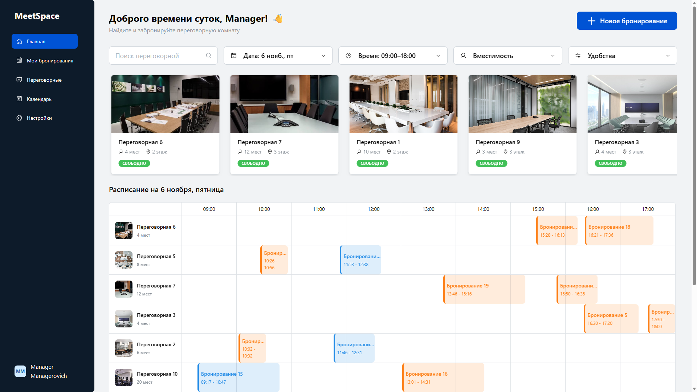

# Setup

## Clone Repository
```
git clone https://github.com/AGR-ALS/MeetSpace.git
cd MeetSpace/
```

## Enter enviromental variables

Create `.env` files and write variables into them according to `.env_examples` files.

For example:
```
POSTGRES_USER=postgres
POSTGRES_PASSWORD=password

DB_NAME=MeetSpaceDb

MINIO_USER=Admin
MINIO_PASSWORD=password
```
Each service contains its own `.env` file, make sure to go through all of them.

You can go with just copypasting contents of `.env_example` files into `.env` files - It will work, just won't be secure.

## Launch the App

```
docker compose up --build -d
```

### You can access the app at [localhost:3000](http://localhost:3000)

## Premade Manager

You can access premade manager user using credentials:
```
email: manager@manager.com
password: manager
```
*(these credentials work in the deployed version as well)*


# Key Features


##  Core Business Logic & Scheduling
- **Conflict-Free Booking Engine:** Implemented strict backend validation to prevent double-booking (overlapping time slots for the same room) and ensure bookings do not fall outside of defined working hours (09:00 - 18:00).
- **Real-Time Occupancy Tracking:** Dynamically calculates and displays the "Occupied Until" status for rooms based on current time and active bookings, providing instant visual feedback on room availability.
- **Multi-Criteria Filtering:** Built a complex filtering system allowing users to search for available rooms by date, time range, capacity, specific amenities (equipment), and text queries.

## UI/UX
- **Interactive Resource Scheduling:** Integrated `@mantine/schedule` (`ResourcesDayView`, `DayView`, `MonthView`) to visualize bookings across multiple rooms (resources) and time slots simultaneously.
- **Custom Algorithm Patch (BFS):** Wrote and applied a custom patch (`@mantine+schedule+9.5.0.patch`) utilizing a **Breadth-First Search (BFS)** algorithm to correctly calculate columns and render intersecting/overlapping calendar events without visual glitches.
- **State Management:** Utilized **Redux (Thunk)** for robust global state management, handling complex asynchronous flows for Users, Rooms, Bookings, and Equipment.
- **Responsive & Adaptive Design:** Designed a fully responsive UI that seamlessly transitions from a Desktop layout (Sidebar Navigation) to a Mobile layout (Bottom Navigation Bar + Floating Action Button for quick booking).
- **Rich UI Components:** Leveraged Mantine UI for complex interactions, including Dropzone for avatar uploads, Carousels for room browsing, and Accordions for nested booking details.

## Backend Architecture & Security
- **Clean Architecture:** Built on **.NET 10** and **ASP.NET Core**, strictly following Clean Architecture principles (Domain, Application, Infrastructure, API) with dependency injection and repository patterns.
- **Secure Authentication & RBAC:** Implemented a secure auth flow using **JWT Access Tokens** and **Refresh Tokens**. Enforced Role-Based Access Control using Policy-Based Authorization.
- **S3-Compatible File Storage:** Integrated **MinIO** for storing room photos and user avatars. Implemented **Presigned URLs** to allow the frontend to upload/download files directly from the storage, bypassing the backend and reducing server load.
- **Global Exception Handling:** Created a centralized Exception Handling Middleware that maps custom domain exceptions (e.g., `EntityNotFoundException`, `DuplicateEmailException`) to standardized HTTP `ProblemDetails` responses.

## Infrastructure
- **Fully Containerized:** Packaged the entire stack (Backend, Frontend, PostgreSQL 18, MinIO) into a single `docker-compose.yml` for seamless local development and deployment.
- **Algorithmic Database Seeding:** Developed complex C# seeders that not only populate Rooms, Equipment, and Many-to-Many mappings but also use algorithms to generate realistic, **non-overlapping historical bookings** for demo purposes.
- **SPA Routing via Nginx:** Configured Nginx in the frontend Docker container to properly handle React Router SPA fallback routing.